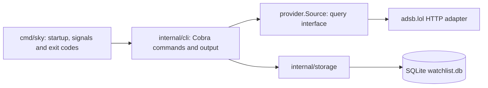

# Sky architecture and Go packages

Sky is a local Go CLI. It requires Go 1.24+; a backend service is not part of the current implementation.

## Current components

| Package | Responsibility |
| --- | --- |
| `cmd/sky` | Assemble the command, handle process cancellation, select stdout/stderr and return an exit status |
| `internal/cli` | Parse/validate arguments, call providers/storage, filter results and render tables/JSON |
| `internal/provider` | Query/result interface, adsb.lol adapter, response validation, typed errors and cooldown metadata |
| `internal/storage` | Identifier normalization, platform data paths, versioned SQLite watchlists and backup/restore |

Live lookups do not require SQLite. Local watchlist operations do not call a provider or require API credentials. Registrations and hex addresses are separate saved targets until identity resolution is implemented.

## Direct third-party dependencies

Versions are pinned in `go.mod` / `go.sum`.

| Go module | Version | Purpose |
| --- | --- | --- |
| `github.com/spf13/cobra` | v1.10.2 | CLI commands, help, argument/flag handling and completions |
| `modernc.org/sqlite` | v1.45.0 | Pure Go SQLite driver registered with `database/sql` |

`github.com/spf13/pflag` v1.0.9 is an indirect Cobra dependency. Other indirect modules support SQLite/platform functionality; `go list -m all` shows the complete graph. No dependency is added by the architecture fixes.

## Standard library packages

| Package | Use |
| --- | --- |
| `net/http`, `net/url` | Provider HTTP requests and safe URL construction |
| `encoding/json` | Provider decoding and CLI JSON output |
| `database/sql` | Database connections and transactions |
| `context`, `os/signal`, `syscall` | Deadlines, cancellation and process signals |
| `os`, `path/filepath` | Files, data directories and recovery publication |
| `time` | UTC timestamps, request deadlines and cooldowns |
| `text/tabwriter` | Aligned terminal tables |
| `testing`, `net/http/httptest`, `os/exec` | Offline HTTP fixtures, database tests and subprocess checks |

Normal builds are CGO-free. Go race testing still needs its normal supported platform/C toolchain. See ADR 0002 for SQLite version/platform tradeoffs and third-party notices for licensing.

## HTTP boundary

The adapter makes one HTTP client call per lookup and rejects all redirects, including same-origin redirects, so provider credentials are not forwarded through Location hops and redirects cannot silently multiply scheduler requests. It shallow-copies the configured `http.Client` before applying the no-redirect policy, preserving the caller's client configuration. Redirect statuses are returned as nonretryable rejected-provider errors (CLI exit 5).

The request context enforces timeout/cancellation. Rate-limit and temporary-failure metadata are typed; callers do not need to parse diagnostic text. Retryable classification alone does not authorize another request.

## Storage boundary

Opening an existing supported database validates identity and table columns in a deferred read transaction. It does not reserve the writer lock merely to open/list targets. Under rollback journaling or WAL, a reader can see committed data while another connection holds uncommitted writes; an exclusive lock can still block readers under SQLite's normal rules.

A new database is initialized in an immediate write transaction. Identity/schema checks are repeated after obtaining that lock, because another process may initialize first. Writes remain immediate and transactional, with the existing busy timeout and primary-key uniqueness guarantees. Unsupported schemas and unrelated data are refused.

Backups use SQLite snapshots. Restore validates and imports into a staged database, then publishes without overwriting an existing destination. File-system hard-link support is required. See WATCHLISTS and RECOVERY for the exact data contracts and recovery limitations.

## Tracking scheduler

`internal/tracking` accepts a snapshot of saved targets and an injectable clock and provider. It normalizes and deduplicates identifiers by kind, preserving input order. A registration and a hex address remain separate until the tool can resolve them to the same aircraft.

Each run requires a positive interval and request budget. The first cycle starts immediately, and later cycles start no sooner than one interval after the previous cycle started. Each attempt consumes one unit, including failures. The plan exposes the full-cycle cost before the first lookup, and each attempt exposes the remaining allowance. A run ends as soon as it exhausts the budget, even partway through a cycle.

Rate limits, temporary failures, and timeouts pause the entire run until both the provider’s Retry-After deadline and the local backoff have elapsed. The local backoff doubles from one second up to one minute and resets on success. Polling resumes with the next target in sequence. Other provider errors, cancellation, and output failures stop the run.

Issue #8 will connect this scheduler to `watch run` and define observation state and terminal and JSON output.

Before introducing a second provider, separate provider wire DTOs from typed internal observations. Current result fields intentionally preserve the alpha JSON contract, including raw altitude number/ground/unknown representation. Shared identifier rules can also replace duplicated validation once that domain boundary is introduced.

Stored aircraft history and a hosted service remain separate roadmap work.
